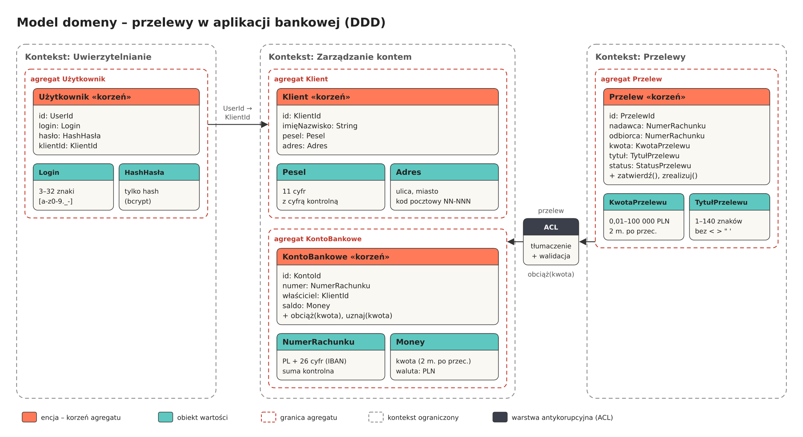

# Zadanie 1 - Domain Driven Design

## Opis zadania

Celem zadania jest zamodelowanie fragmentu aplikacji bankowej z wykorzystaniem zasad Domain Driven Design. Wybrany fragment to zlecanie przelewu przez zalogowanego klienta. System podzielono na trzy konteksty ograniczone (Uwierzytelnianie, Zarządzanie kontem, Przelewy), w których wyznaczono agregaty, encje i obiekty wartości. Obiekty wartości same sprawdzają swoje dane przy tworzeniu, więc obiekt z niepoprawnymi danymi w ogóle nie może powstać, a dane przekazywane między kontekstami są dodatkowo walidowane w warstwie ACL.

## Model

## Konteksty ograniczone

| Kontekst | Za co odpowiada | Agregaty |
|---|---|---|
| Uwierzytelnianie | logowanie użytkownika | `Użytkownik` |
| Zarządzanie kontem | dane klienta, konta i saldo | `Klient`, `KontoBankowe` |
| Przelewy | zlecanie i realizacja przelewów | `Przelew` |

## Agregaty i encje

Każda encja jest korzeniem swojego agregatu. Agregaty odwołują się do siebie tylko przez identyfikatory (np. konto przechowuje `KlientId`, a nie cały obiekt klienta). Identyfikatory to UUID generowane przez system.

| Encja (korzeń) | Atrybuty | Reguły |
|---|---|---|
| `Użytkownik` | `id`, `login`, `hasło`, `klientId` | po 5 nieudanych logowaniach konto jest blokowane |
| `Klient` | `id`, `imięNazwisko`, `pesel`, `adres` | wszystkie pola wymagane; imię i nazwisko: 1–50 znaków, tylko litery, spacja i `-` |
| `KontoBankowe` | `id`, `numer`, `właściciel`, `saldo` | saldo nie może spaść poniżej 0; zmiana salda tylko przez `obciąż()` i `uznaj()` |
| `Przelew` | `id`, `nadawca`, `odbiorca`, `kwota`, `tytuł`, `status` | nadawca ≠ odbiorca; status: `NOWY → ZATWIERDZONY → ZREALIZOWANY` lub `ODRZUCONY` |

## Obiekty wartości i akceptowane formaty

| Obiekt wartości | Format / ograniczenia |
|---|---|
| `Login` | 3–32 znaki, tylko małe litery, cyfry oraz `. _ -` |
| `HashHasła` | hasło 12–128 znaków; zapisywany jest tylko hash (bcrypt), nigdy jawne hasło |
| `Pesel` | dokładnie 11 cyfr, poprawna cyfra kontrolna |
| `Adres` | ulica i miasto: 1–100 znaków; kod pocztowy w formacie `NN-NNN` |
| `NumerRachunku` | `PL` + 26 cyfr (IBAN), poprawna suma kontrolna |
| `Money` | kwota dziesiętna z 2 miejscami po przecinku (nie `float`), waluta `PLN` |
| `KwotaPrzelewu` | od 0,01 do 100 000,00 PLN – kwota ujemna lub zero jest odrzucana |
| `TytułPrzelewu` | 1-140 znaków; dozwolone litery, cyfry, spacja i `. , - /`; znaki `< > " '` są odrzucane |

## Integracja między kontekstami

1. **Uwierzytelnianie → Zarządzanie kontem:** po zalogowaniu `UserId` jest tłumaczony na `KlientId`. Klient ma dostęp tylko do kont, których jest właścicielem.
2. **Przelewy:** klient tworzy `Przelew` (status `NOWY`). Dane wejściowe są od razu zamieniane na obiekty wartości, więc np. przelew na kwotę `-100` nie powstanie. Po zatwierdzeniu status zmienia się na `ZATWIERDZONY`.
3. **Przelewy → Zarządzanie kontem (przez ACL):** warstwa antykorupcyjna sprawdza, czy rachunek nadawcy należy do klienta, i wywołuje `konto.obciąż(kwota)`.
4. **Zarządzanie kontem → Przelewy:** jeśli środków wystarczy, konto zostaje obciążone, a przelew przechodzi w stan `ZREALIZOWANY`. W przeciwnym razie przelew jest `ODRZUCONY`.
